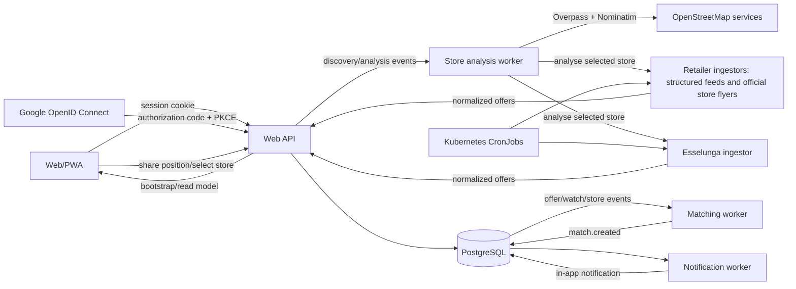

# SpesaVicina architecture

## Runtime flow

All services run in the `grocery-offers` namespace. Only the web API is externally routed. People authenticate with email/password or Google OpenID Connect; ingestors authenticate to internal API routes with a separate Kubernetes Secret.

## Data ownership

- `profiles`, `password_credentials`, `auth_identities`, `auth_sessions`: accounts, authentication methods, and revocable server-side sessions;
- `profile_stores`, `watch_items`: each profile's explicitly shared location/store choices and product intent;
- `products`, `product_aliases`, `product_identifiers`: canonical product identity;
- `stores`, `offers`, `ingestion_runs`: discovered stores, retailer evidence, and ingestion history;
- `store_analysis_jobs`, `service_notifications`: asynchronous discovery/analysis state and durable user-visible completion messages;
- `matches`: immutable, idempotent exact-product decisions;
- `notifications`, `feedback`: in-app delivery and usefulness signals;
- `outbox_events`: durable inter-service events and retry state.

Foreign keys protect the core graph and unique constraints provide idempotency for watches, offers, matches, and notifications. Every private API query is scoped by the profile ID derived from the authenticated session; clients never choose that ID. Products, stores, and offers are shared catalogue evidence, while profile choices, locations, jobs, alerts, and feedback remain tenant-private.

## Event contracts

| Event | Producer | Consumer | Meaning |
|---|---|---|---|
| `offer.changed` | API ingestion/review | matching worker | An offer is new or materially updated |
| `watch.changed` | public API | matching worker | A watched product or threshold changed |
| `store.changed` | public API | matching worker | Store selection changed |
| `catalogue.seeded` | API startup | matching worker | Initial data may be matchable |
| `match.created` | matching worker | notification worker | A unique qualifying exact match was created |
| `store.discovery.requested` | public API | store analysis worker | Discover and rank stores around an explicitly shared position |
| `store.analysis.requested` | public API / analysis sweep | store analysis worker | Collect current offers for a selected store without blocking the UI |

Events are inserted in the same PostgreSQL transaction as the state change. Consumers claim unlocked events, process idempotently, and record `processed_at`. Failures release the event with exponential backoff and preserve the error text.

## Matching rule

A notification is eligible only when all conditions hold:

1. the watch is active;
2. the store is selected;
3. the offer is approved and not expired;
4. `watch.product_id = offer.product_id`;
5. both list price and offer price are known;
6. `list_price - price >= watch.min_saving`.

The database uniqueness constraint on `(watch_id, offer_id)` guarantees the single-alert trigger.

## Service boundaries

Authentication stays in the API because it owns the profile boundary and server sessions. Google sign-in uses authorization code + PKCE with state and nonce; password credentials use salted scrypt hashes. Catalogue/profile/watch endpoints remain together because splitting CRUD by table would add network failure modes without an independent scaling or ownership need. Retailer adapters and asynchronous workers are separate because they fail, scale, and deploy independently. Location is captured only when the person presses the geolocation control; no continuous tracking process runs. Outbound email is deliberately omitted.

## Operations

Every long-running service exposes `/healthz`, `/readyz`, and Prometheus text metrics. API logs and worker logs are structured JSON. PostgreSQL reports slow statements above one second. Resource requests and limits are set for every workload.

Recommended production follow-ups are automated PostgreSQL backups, a labelled connector accuracy suite, alert latency dashboards, dead-letter inspection, and a private multi-architecture image registry so Carrefour can run with Poppler.
